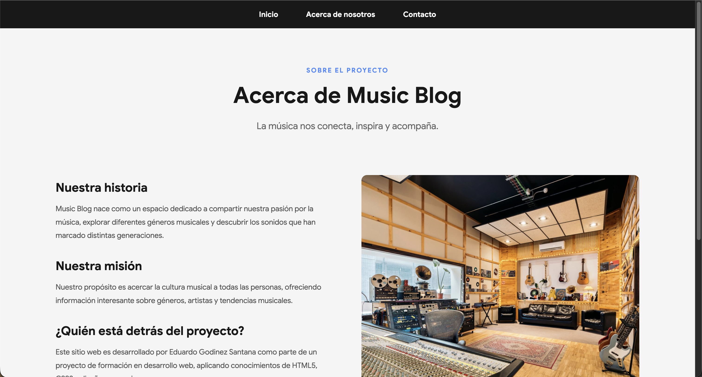
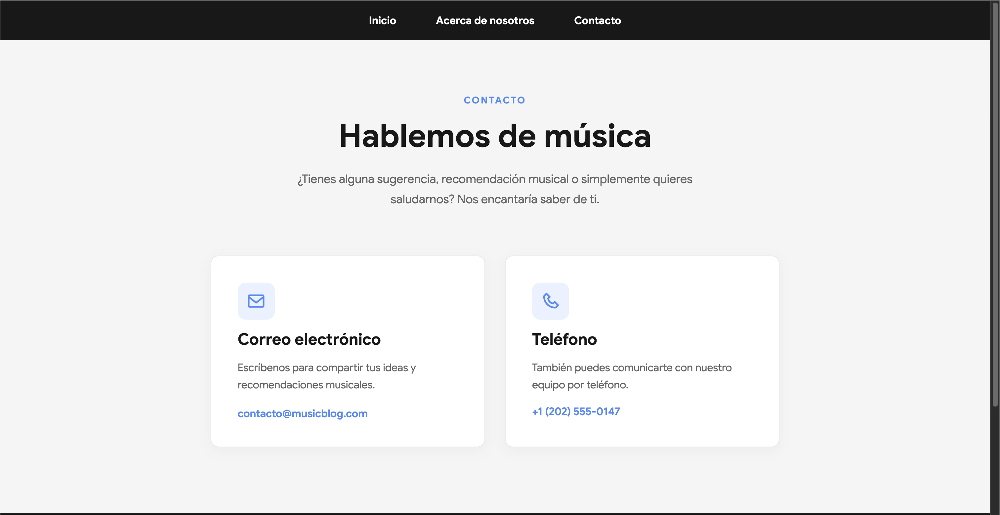

# 🎵 Music Blog

**Un espacio para compartir nuestra pasión por la música.**

Music Blog es un sitio web dedicado a explorar el mundo de la música, conocer diferentes géneros musicales y descubrir su historia, características y principales exponentes.

El proyecto fue desarrollado como parte del laboratorio **AD-07: Creating Your Own Blog**, del Bootcamp de Desarrollo Java Full Stack de Generation, con el propósito de aplicar conocimientos de HTML5, CSS3, diseño web responsivo y control de versiones con Git y GitHub.

## Características principales

- **Página de inicio:** sección Hero con imagen panorámica, tarjetas de géneros musicales y artículos informativos.
- **Exploración musical:** contenido dedicado al Rock, Jazz y Música electrónica.
- **Acerca de nosotros:** presentación del proyecto, su historia, misión y responsable.
- **Página de contacto:** información de contacto demostrativa con íconos de Boxicons.
- **Navegación:** menú persistente mediante `position: sticky`.
- **Diseño responsivo:** adaptación a dispositivos móviles, tablets y computadoras.
- **Identidad visual:** uso de CSS personalizado, tipografía Google Sans y variables para centralizar los colores.

## Tecnologías utilizadas

| Tecnología | Uso |
|---|---|
| HTML5 | Estructura semántica del sitio |
| CSS3 | Diseño, estilos y animaciones |
| CSS Flexbox | Distribución del menú y footer |
| CSS Grid | Organización de tarjetas y secciones |
| Boxicons | Iconografía de la página de contacto |
| Git | Control de versiones |
| GitHub | Repositorio y seguimiento del proyecto |
| GitHub Projects | Organización del Backlog SCRUM |

## Estructura del proyecto

```text
AD-07-LAB_El-sitio-del-blog/
├── Pic/
│   ├── about.jpeg
│   ├── electric.jpeg
│   ├── hero.jpeg
│   ├── jazz.jpeg
│   └── rock.jpeg
├── index.html
├── about.html
├── contact.html
├── style.css
├── .gitignore
└── README.md
```

El proyecto utiliza un único archivo CSS personalizado para mantener la consistencia visual entre sus tres páginas.

## Instalación y ejecución

**1. Clonar el repositorio**

```bash
git clone https://github.com/EdGodinez/AD-07-LAB_El-sitio-del-blog.git
```

**2. Acceder al directorio**

```bash
cd AD-07-LAB_El-sitio-del-blog
```

**3. Abrir el proyecto**

Abre la carpeta en Visual Studio Code y ejecuta `index.html` desde tu navegador.

También puedes utilizar la extensión Live Server de VS Code para visualizar los cambios durante el desarrollo.

No requiere instalación de dependencias ni configuración de un servidor backend.

## Organización del proyecto

El desarrollo se organizó mediante GitHub Projects e Issues, utilizando un tablero Kanban con los siguientes estados:

- Backlog
- Todo
- In progress
- Done

El laboratorio se dividió en siete tareas: configuración del repositorio, organización SCRUM, navegación, footer, página de inicio, About Us y Contact Us.

## Capturas de pantalla

### Página de inicio


### Acerca de nosotros


### Contacto


## Autor

**Eduardo Godinez Santana**

Ingeniero en Sistemas Computacionales

GitHub: https://github.com/EdGodinez

## Contexto académico

**Programa:** Bootcamp de Desarrollo Java Full Stack — Generation CH73

**Laboratorio:** AD-07 — Creating Your Own Blog

**Proyecto:** Music Blog

**Año:** 2026

---

*Proyecto desarrollado con fines educativos para fortalecer habilidades de desarrollo web frontend.*